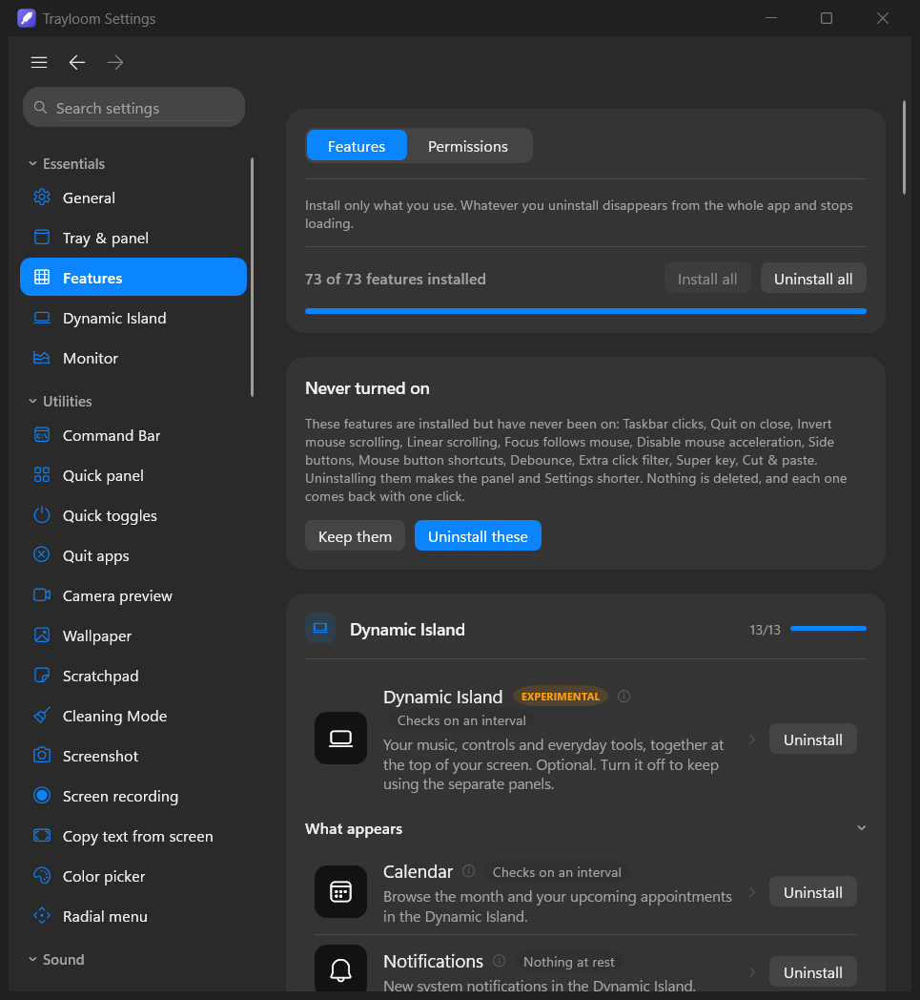
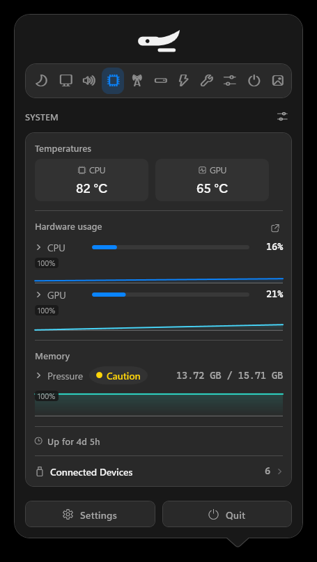
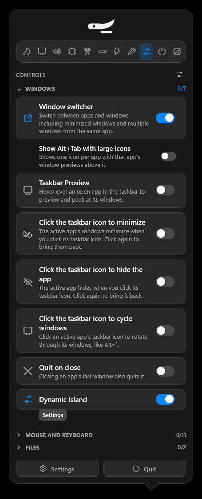
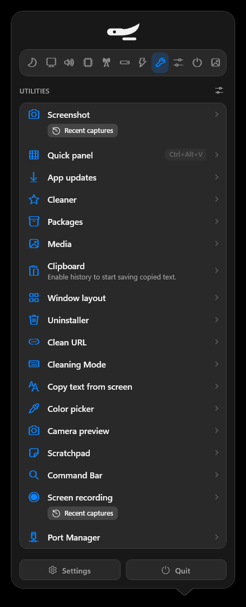
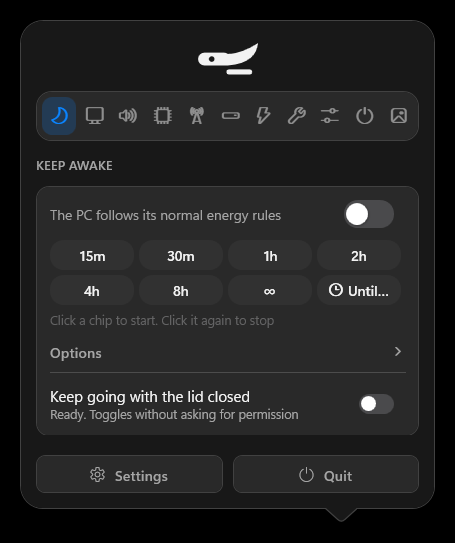
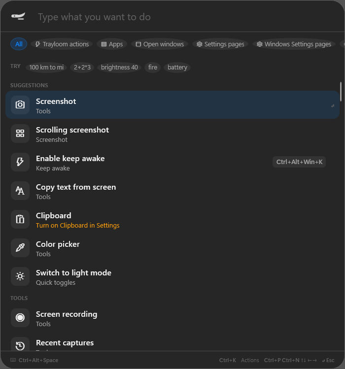
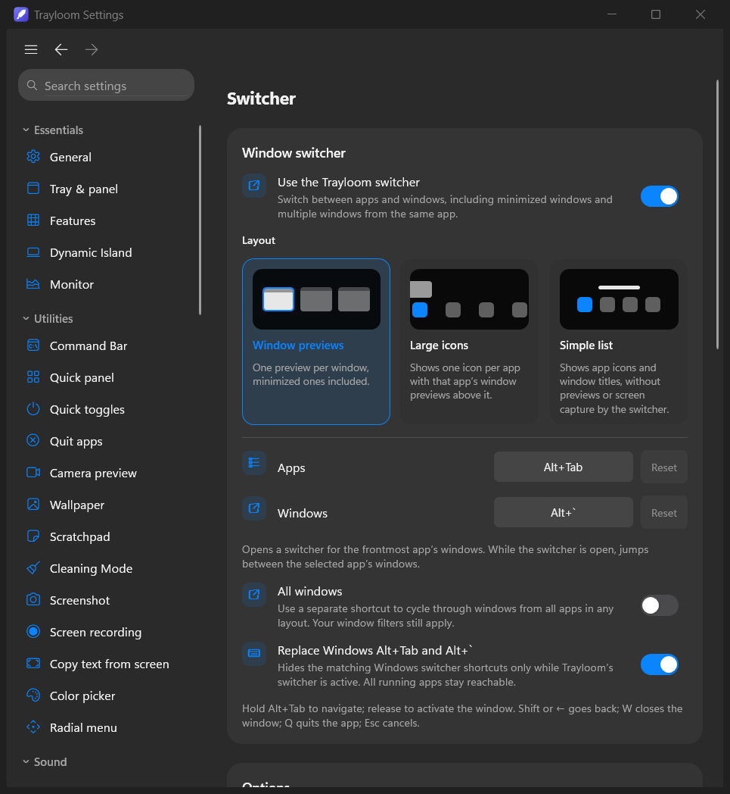
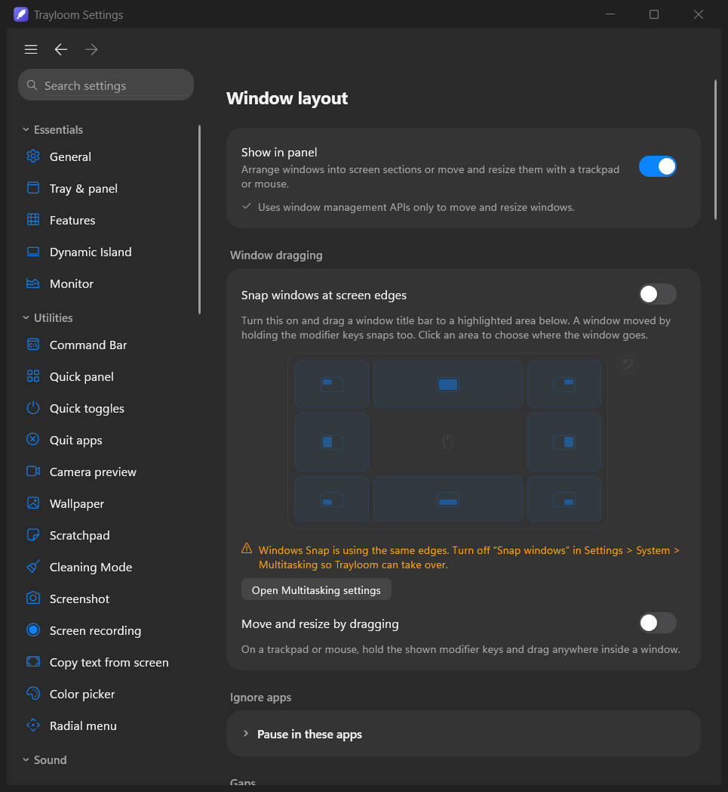
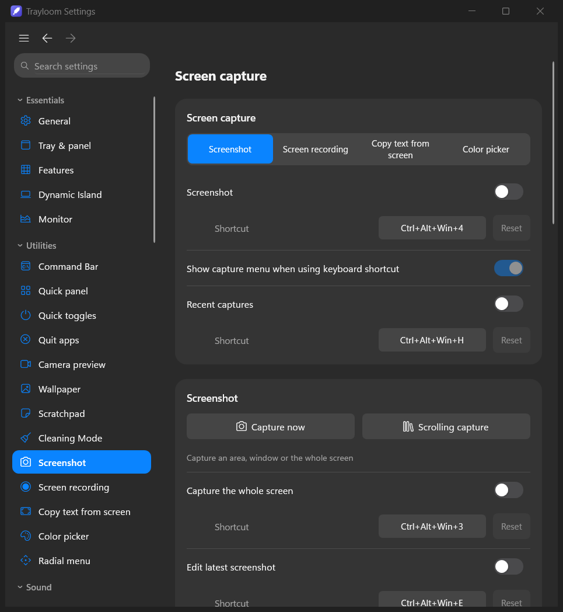

<div align="center">

# Trayloom

### Dozens of small Windows tools, woven into one tray icon.

**Install only the threads you need. Everything you leave out never loads.**

[](#requirements)
[](#build-from-source)
[](#everything-trayloom-can-do)
[](#privacy)
[](LICENSE)

[Why Trayloom](#why-trayloom) · [Screenshots](#a-quick-look) · [Features](#everything-trayloom-can-do) ·
[Use cases](#who-it-is-for) · [Install](#install) · [Shortcuts](#keyboard-shortcuts) · [Performance](#how-light-is-it) ·
[Build](#build-from-source)

<br />



</div>

---

## Why Trayloom

Most Windows power users end up with a tray full of single-purpose apps: one for the clipboard, one for window snapping, one
for keeping the PC awake, one for screenshots, one for per-app volume, another for system stats. Each one starts with Windows,
each one has its own settings, update channel and memory footprint.

**Trayloom replaces that pile with one app.** It ships 77 tools in one place: window management, input tweaks, clipboard
and file helpers, sound controls, screen capture, system monitoring, app maintenance and a Dynamic Island at the top of your
screen. Three ideas shape it:

| | |
| --- | --- |
| **Install what you use** | Every tool is installed or uninstalled on its own from the **Features hub**. An uninstalled tool is gone from the panel, Settings, the Command Bar and memory. Nothing runs in the background "just in case". |
| **Leave no trace** | Every tool undoes what it changed when you turn it off, uninstall it or quit Trayloom: mouse acceleration comes back, hooks and hotkeys are released, wake locks end, windows return to where they were. |
| **Stay local** | Your clipboard, notes, screenshots, AI-agent usage and system stats are read and stored on your PC. Trayloom has no account, no telemetry and no cloud service. |

## A quick look

<table>
  <tr>
    <td align="center" width="25%"><br /><sub><b>System monitor</b><br />Temperatures, usage, memory pressure</sub></td>
    <td align="center" width="25%"><br /><sub><b>Controls</b><br />Every switch, one click away</sub></td>
    <td align="center" width="25%"><br /><sub><b>Utilities</b><br />Tools you launch when you need them</sub></td>
    <td align="center" width="25%"><br /><sub><b>Keep awake</b><br />Timers, rules, lid closed</sub></td>
  </tr>
</table>

<table>
  <tr>
    <td align="center" width="50%"><br /><sub><b>Command Bar</b>: one field that finds and runs everything (Ctrl+Alt+Space)</sub></td>
    <td align="center" width="50%"><br /><sub><b>Window switcher</b>: an Alt+Tab with previews, large icons or a simple list</sub></td>
  </tr>
  <tr>
    <td align="center" width="50%"><br /><sub><b>Window layout</b>: snap zones, gaps and drag-to-move</sub></td>
    <td align="center" width="50%"><br /><sub><b>Screen capture</b>: screenshots, recordings, text and colour picking</sub></td>
  </tr>
</table>

## Everything Trayloom can do

The tools are grouped the same way as in the Features hub. Each line says what the tool does and when it helps.

### Windows and taskbar

| Tool | What it does |
| --- | --- |
| **Window switcher** | A full Alt+Tab replacement with window previews, large icons or a simple list. Includes minimized windows, lets you jump between windows of one app (Alt+\`), close (W) or quit (Q) from the switcher. |
| **Taskbar Preview** | Hover an app in the taskbar to preview and peek at its windows. |
| **Taskbar clicks** | Click the active app's taskbar icon to minimize it, hide it, or cycle through its windows. |
| **Window layout** | 41 placements (halves, thirds, two-thirds, corners, centre, next display) from the keyboard, a directional ring, edge snapping with a visual zone map, configurable gaps, and move or resize any window by holding Ctrl+Alt and dragging anywhere inside it. |
| **Quit on close** | Closing an app's last window also quits the app. |

### Mouse and keyboard

| Tool | What it does |
| --- | --- |
| **Invert mouse scrolling** | Flip the wheel direction, vertically and horizontally, for mice only. |
| **Scroll sideways while holding a key** | Hold a modifier you pick and the normal wheel scrolls horizontally. Great for timelines and wide spreadsheets. |
| **Zoom** | Pinch-style zoom with the wheel and a modifier. |
| **Focus follows mouse** | The window under the pointer gets focus without clicking. |
| **Smooth scrolling** | Animated, eased wheel scrolling everywhere. |
| **Linear scrolling** | Every wheel notch scrolls the same distance, however fast it spins. The touchpad is not affected. |
| **Disable mouse acceleration** | Raw, predictable pointer movement for connected mice; your old setting returns when you turn it off. |
| **Side buttons** | Mouse side buttons go back and forward, even in apps that ignore them. |
| **Mouse button shortcuts** | Map extra buttons and side-wheel directions to any key combination. |
| **Extra click filter** | Ignores the phantom double clicks of a worn mouse button without slowing normal clicks. |
| **Debounce** | Ignores accidental double key presses from a chattering keyboard. |
| **Text snippets** | Short triggers expand into full text, with a snippet library and date placeholders. |
| **Super key** | Turn one key into a modifier combination you choose, such as Ctrl+Alt+Win. |
| **Quit & close protection** | Alt+F4 and Ctrl+W ask you to hold them, so a slip never closes your work. |

### Clipboard and files

| Tool | What it does |
| --- | --- |
| **Clipboard** | A searchable local history of what you copy, with cards, list and pile views. |
| **Paste as plain text** | Paste without fonts, colours or formatting. |
| **Cut & paste** | Real cut and paste of files in File Explorer, plus pasting a copied image straight in as a file. |
| **Rename shortcut** | Rename the selected file or folder with a shortcut you choose. |
| **Shelf** | Drop files on the screen edge to hold them while you find where they go. |
| **Clean URL** | Copied links lose their tracking parameters automatically. |
| **Media** | Compress videos, images, GIFs and PDFs without opening an editor. |

### Sound

| Tool | What it does |
| --- | --- |
| **Volume mixer** | Per-app volume and per-app output device, with pinning and your own order. |
| **Output switcher** | Cycle speakers, headphones and other outputs with one shortcut. |
| **Audio device priority** | Automatically switch to your preferred output and microphone when they connect. |
| **Mute microphone** | Mute the mic from anywhere with a shortcut; the tray icon shows when it is muted. |
| **Music app blocker** | Stops media keys from launching a music app you did not ask for. |

### Energy and display

| Tool | What it does |
| --- | --- |
| **Keep awake** | Keep the PC awake for 15 minutes, a few hours, until a time, or forever, with rules and an option for when the lid is closed. The tray icon can show the minutes left. |
| **Displays** | Brightness and power for every display, including external monitors over DDC/CI. |
| **Bluetooth on sleep** | Bluetooth turns off while the PC sleeps, so headphones in your bag stop connecting to it. |

### Tools

| Tool | What it does |
| --- | --- |
| **Command Bar** | One search field that runs any Trayloom action, opens apps, windows and Settings pages, converts units and does maths (`100 km to mi`, `2+2*3`, `brightness 40`). |
| **Quick panel** | A floating grid of your favourite tools, opened with a shortcut. |
| **Quick toggles** | One-click actions such as switching dark mode or emptying the Recycle Bin. |
| **Radial menu** | A wheel of your favourite actions that opens around the pointer. |
| **Screenshot** | Capture an area, a window or the whole screen, annotate it in the editor, take scrolling captures and pin shots on screen. |
| **Screen recording** | Record an area, window or screen with system audio and microphone, then trim, zoom, blur and export to video or GIF. |
| **Copy text from screen** | Select any part of the screen to copy its text, or read a QR code. |
| **Color picker** | Pick any colour on screen and copy it in the format you need. |
| **Camera preview** | A floating mirror of your webcam before a call. |
| **Scratchpad** | Floating pads for short-lived notes, with tabs and formatting. |
| **Cleaning Mode** | Locks the keyboard and blanks the screen so you can wipe them. |
| **Away mode** | Minimizes your windows when you leave the PC, or (optionally) when the camera stops seeing you, and brings them back in the same order when you return, by mouse, unlock or (optionally) when the camera sees you. Optionally closes the apps you choose and opens them again, browsers with their tabs. |
| **Modes** | One-click workspaces: open the apps, folders and browser tabs of a task, like coding or studying, put the others away, and save what is open now as a mode. Start one from the Dynamic Island, the tray, the Quick panel, the Command Bar or its own shortcut. |
| **Quit apps** | Quit open apps one by one, all at once, or all but the one in front, always after showing the list. |
| **Wallpaper** | Pick a still wallpaper without opening Windows Settings. |
| **Cleaner** | Find and clear caches and junk files, with a review before anything is removed. |
| **Uninstaller** | Remove apps together with the leftovers they leave behind. |
| **Packages** | Keep your `winget` packages up to date from the panel. |
| **App updates** | Find and install updates for the apps you already have. |
| **Kill Process** *(beta)* | Search running processes and force quit, restart or end a whole process tree. |
| **Port Manager** | See which processes listen on which ports, and end them (with Kill Process installed). |

### Dynamic Island

An optional, always-there capsule at the top of your screen (or any edge, on any display) that grows into a panel when you
need it. Its layout, size, buttons and pages are all yours to arrange.

| Extension | What it does |
| --- | --- |
| **Dynamic Island** | Music, volume, brightness and your everyday tools in one place at the top of the screen. |
| **Calendar** | Browse the month and your upcoming appointments, from Google Calendar or Windows Calendar. Join Google Meet and other video calls in one click. |
| **Notifications** | New system notifications appear in the island. |
| **Gestures** | Open and close the island by scrolling; swipe to change tracks. |
| **Timer** | Timers, a stopwatch and focused work sessions. |
| **Screen time** | How long you used the PC today and which apps, with an hour-by-hour chart. App names and times stay on your PC. |
| **Accessory alerts** | See connected accessories and get one warning when a battery drops to 20%. |
| **Bluetooth** | See your Bluetooth devices and their battery in the island and the tray, turn Bluetooth on or off, and get one alert when a device runs low. |
| **Lyrics** | Follow the lyrics of the current song (online lookup is **off** until you turn it on). |
| **Up next** | The real upcoming songs your player shares. |
| **Bars follow the music** | The island's bars move with the sound your player makes. |
| **Downloads** | Watch files arrive in a folder you choose. |
| **Watch** | Turn any part of any window into a live activity, with an alert when it changes, finishes or shows what you are waiting for. |
| **AI Agents** | Plan limits, tokens, API value and live sessions of Claude, Codex, OpenCode and GitHub Copilot (see below). |
| **GitHub** | Unread notifications, your pull requests, reviews waiting for you, failing checks and latest releases (online only after you connect, through the GitHub CLI or an encrypted token). While you code, the island follows the repository in front of you: branch, changes, pull request and checks, with an alert when checks finish. |
| **Wi-Fi** | Your network and signal, the Wi-Fi switch, nearby networks with join and disconnect. |
| **Companion** | A small friend in the island who says hello now and then and reacts to what happens on your PC. |

The island's music page can also browse Spotify and YouTube Music in its Library, next to Apple Music: turn each one on in
Settings › Dynamic Island › Content › Now Playing. Spotify needs your own Spotify Client ID; YouTube Music search works with no
key and no account (your own YouTube Data API key is an optional alternative). Both are off until you turn them on (see
[Privacy](#privacy); setup steps are in [docs/INSTALL.md](docs/INSTALL.md#spotify-and-youtube-music-optional)).

### Away mode and GitHub, in detail

* **Away mode** minimizes your windows and restores them in the same order. Closing apps is off until you turn on **Close apps
  while I’m away** and choose apps; Chrome and Edge then close the way they do for a Windows update restart and reopen with the
  same windows and tabs. Private windows can’t be reopened, so a browser with one open is only minimized, and so is an app that
  asks to save something. What was closed is remembered on your PC only until it is open again. Face detection is detection,
  not recognition: any face counts, so it cannot tell you from a colleague. For real protection, switch on **Lock the PC too**.
  **Leave when the camera doesn’t see you** (off by default) turns the camera on only after 30 seconds without the mouse or
  keyboard. If it sees no face and no movement for the time you choose, a 10-second notice appears in the island (or as a
  toast) and any movement or key press cancels it; then Away mode starts. It never counts a dark room or a covered lens as
  absence, and it stays off during calls, media, full screen, battery saver and while the PC is locked. Pictures are checked
  in memory and never saved; the camera light is on while it checks. **Which apps** can limit closing to the list, add the
  apps of the mode you are in, or cover every app with a window (File Explorer, terminals and anything under “Leave these
  apps alone” are never closed).
* **Modes** keep their list in `%APPDATA%\Trayloom\modes\modes.json` on your PC. “Save what’s open now” lists what it found
  and saves nothing until you confirm. Switching never closes a window that asks to save something and never closes File
  Explorer or terminals; a mode can only close windows it opened itself. It does not turn on Do not disturb or change per-app
  volume, and it refuses to run while Trayloom itself runs as administrator.
* **GitHub** is offline until you connect it. It then uses the GitHub CLI you are already signed in to, or a token you paste
  that is stored encrypted with Windows DPAPI for your account. It is read-only: Trayloom never writes to GitHub.

### System monitor

CPU, GPU, Memory, Network, Disks, Power and Connected devices, with usage, temperatures, graphs and memory pressure. Show
them in the tray panel or as a live strip next to the tray icon.

### AI Agents, in detail

For people who work with coding agents all day, **AI Agents** keeps their limits and activity in view without opening a
browser tab.

* **Limits:** session and weekly windows, with where each number came from and how fresh it is ("From Claude Code, 2
  minutes ago"). When a source is missing the card says so instead of guessing.
* **Now:** the live sessions, including background agents, and what each one is doing.
* **Spending:** the *API-equivalent value* of your tokens by model and project. It is what the usage would cost at API
  prices, **not what you pay** on a subscription.
* **Permission alerts:** when a Claude Code session waits for your permission, the island pops out to tell you which one.
  This uses a small, optional hook that only reports the event; it is added only when you switch it on (after a backup of
  your settings) and removed when you switch it off.
* **Mascot:** Claude Code’s pixel mascot opens a laptop and types on it in the island while Claude works, as it does in Claude Code, and waves when it needs you.
* Everything is read from local files and local services. No passwords or login tokens are read.

## Who it is for

* **Developers.** The Command Bar, Port Manager, Kill Process, AI Agents limits, Window layout for an editor-plus-terminal
  split, Text snippets for boilerplate, and Keep awake for long builds.
* **Designers and content creators.** Screenshot with annotations, screen recording with zoom and blur, Color picker, Copy
  text from screen, Media compression and the Shelf for dragging assets between folders.
* **Laptop users.** Keep awake with the lid closed, Bluetooth on sleep, battery and power in the monitor, Accessory alerts,
  and the lean *Battery and quiet* bundle that never listens to input.
* **People with many apps open.** The Window switcher, Taskbar clicks, Quit on close, Quit apps and Focus follows mouse.
* **Anyone with a worn mouse or keyboard.** Extra click filter and Debounce fix double clicks and double letters without
  new hardware.
* **Music listeners.** The Dynamic Island with music controls, lyrics, Up next, per-app volume and the Music app blocker.
* **Anyone who keeps their PC tidy.** Cleaner, Uninstaller with leftovers, Packages and App updates, all in one place.

## Install

1. Get `Trayloom-win-x64.zip` from the [Releases](https://github.com/Naveen022006/Trayloom/releases) page (or
   [build it yourself](#build-from-source)), unzip it anywhere and run `Trayloom.exe`. Setting it up on another PC, or
   Windows warns about it? [docs/INSTALL.md](docs/INSTALL.md) walks through every step.
2. Choose **Install Trayloom**. It installs for your account only, so no administrator password is needed:
   * the app goes to `%LOCALAPPDATA%\Programs\Trayloom`,
   * a Start menu shortcut is added, plus an optional Desktop shortcut and an optional *start when I sign in* entry,
   * Trayloom appears in **Settings > Apps > Installed apps** so it can be uninstalled like any other app.

   Prefer a portable copy? Choose **Just run it** instead.
3. A short introduction lets you pick a starting bundle:
   * **Essentials** *(default)*: Volume mixer, System monitor and Keep awake.
   * **Windows**: Window switcher, Window layout and the taskbar tools.
   * **Battery and quiet**: a lean monitor with battery, memory and processor. Nothing listens to input.
   * Or pick tools one by one. Everything else is one click away in the Features hub.
4. Find the icon **next to the clock**. Windows hides new tray icons behind the **^** arrow; to keep Trayloom visible, open
   Settings > Personalization > Taskbar > **Other system tray icons** and switch it on (the introduction has a button for
   this).

**Daily use:** click the tray icon for the panel, right-click it for the menu, and press **Ctrl+Alt+Space** for the Command
Bar. Starting Trayloom again from the Start menu while it runs opens Settings on the page you used last.

**Uninstall:** Settings > Apps > Installed apps > Trayloom > Uninstall. Trayloom quits, removes its files, shortcuts and
start-up entry, and asks whether to keep your settings.

## Keyboard shortcuts

Every shortcut is editable in **Settings > Keyboard shortcuts**, and every default is unique. A shortcut is only registered
while its tool is installed **and** switched on, so a fresh install takes almost no key combinations. If Windows or another
program already owns a combination, Trayloom picks a fallback, shows it in the settings row and keeps the rest of the tool
working.

| Action | Default |
| --- | --- |
| Command Bar | Ctrl+Alt+Space |
| Window switcher: apps / windows of one app / all windows | Alt+Tab / Alt+\` / Ctrl+Alt+Tab |
| Window layout: halves | Ctrl+Alt+Left / Right / Up / Down |
| Window layout: thirds, two thirds, corners | Ctrl+Alt+D F G, E T, U I J K |
| Window layout: maximize / centre / restore / next display | Ctrl+Alt+Enter / C / R, Ctrl+Alt+Win+Right |
| Directional ring | Ctrl+Alt+Shift+Space (hold, then pick a direction) |
| Move / resize any window by dragging | Hold Ctrl+Alt (add Shift to resize) |
| Move pointer to next display | Ctrl+Alt+Win+Z |
| Quick panel | Ctrl+Win+V (or Ctrl+Alt+V when taken) |
| Clipboard history / Paste as plain text | Ctrl+Alt+Win+V / Alt+Shift+Win+V |
| Shelf / Snippet menu | Ctrl+Alt+Win+D / Ctrl+Alt+Win+L |
| Rename in File Explorer | F2 |
| Output switcher / Mute microphone / Keep awake | Ctrl+Alt+Win+S / M / K |
| Display brightness down / up | Shift+Win+- / Shift+Win+= |
| Scratchpad / Camera preview | Ctrl+Alt+Win+N / W |
| Quit all apps / all but the front one | Ctrl+Alt+Win+Q / O |
| Radial menu | Ctrl+Alt+Win+Space |
| Screenshot / whole screen / recent / edit latest / edit clipboard | Ctrl+Alt+Win+4 / 3 / H / E / P |
| Screen recording / Copy text from screen / Color picker | Ctrl+Alt+Win+5 / T / C |
| Dynamic Island | Ctrl+Alt+Win+I |

> Some Intel graphics drivers use Ctrl+Alt+Arrow to rotate the screen. If yours does, turn that off in the Intel control
> panel or change the Window layout shortcuts.

## How light is it?

Measured on an Intel Core i7-14700HX laptop (28 threads, 16 GB RAM, RTX 4050) with **all 77 tools installed** and the Dynamic
Island showing, sampled once a second for a minute while idle:

| Resource | Idle, everything installed |
| --- | --- |
| CPU | **~0.2%** of the whole processor (peaks under 1%) |
| GPU | **~0.8%** (drawing the always-visible island) |
| Memory | **~650–700 MB** |
| Disk | ~190 MB installed (self-contained, the .NET runtime included) |

What to expect:

* **Fewer tools means less memory.** With just the default *Essentials* bundle, Trayloom needs a fraction of that, since
  uninstalled tools never load. The AI Agents extension alone can keep a few hundred MB when you have a very large agent
  history.
* **Short bursts while you use something.** Opening the panel or Settings, smooth scrolling and window dragging use a few
  percent of the CPU for a moment.
* **Screen recording is the heaviest tool.** It uses noticeably more CPU and GPU while recording, and exporting a 15-second clip
  takes about 15 seconds and up to 1–2 GB of memory for a moment.

## Privacy

* No account, no sign-in, no telemetry, no ads.
* Clipboard history, snippets, scratchpads, captures and settings are stored in `%APPDATA%\Trayloom` on your PC.
* The only online features are ones you switch on yourself: lyrics lookup, Spotify and YouTube Music search, GitHub status
  (after you connect), app and package updates, and links you choose to open. Feedback opens a GitHub issue in your browser.
* Tools that need a Windows permission (screen capture, microphone, camera, calendar, notifications) list it on the
  **Permissions** tab of the Features hub before you install them.
* **Modes and your browser tabs.** Only when you press **Add current browser tabs** or **Save what’s open now**, Trayloom reads
  the addresses of the open tabs of Chrome and Edge from the browser’s own session file on your PC. They are read in memory,
  never sent anywhere, and nothing is kept unless you save the mode (then the addresses are stored in `modes.json` on your PC).
  Page titles are not read, and private windows are never in that file.
* **Spotify and YouTube Music (optional).** Nothing is sent until you turn a service on in Settings › Dynamic Island › Content › Now Playing. Spotify sign-in happens on Spotify’s own page in your browser (Trayloom never sees your password); Trayloom asks only to read your playlists, liked and recently played songs and what’s playing, and to control playback, and never changes your library or playlists. The sign-in is stored encrypted for your Windows account in `%APPDATA%\Trayloom\music`; Disconnect deletes it, and spotify.com/account/apps removes access. YouTube Music needs no account and no key: when you press Enter in its search box, Trayloom sends the search text to music.youtube.com’s own web service (the one the YouTube Music website uses), with no cookies and no sign-in, and shows the results in the island. That service is not an official API, so it may stop working if YouTube changes it. If you add your own YouTube Data API key (optional, stored encrypted the same way), searches go to Google’s official YouTube Data API instead. YouTube’s Terms of Service and Google’s Privacy Policy apply to those searches. Results are kept in memory only.
* **Google Calendar (optional).** Nothing is sent until you add a calendar in Settings › Dynamic Island › Content › Calendar. Trayloom then downloads that calendar’s secret iCal address from calendar.google.com every 15 minutes (you can change this) and shows its events in the island. It is read-only: Trayloom never signs in to Google and never changes your calendar. The address works like a password, so Trayloom stores it, and a copy of the downloaded calendar, encrypted for your Windows account in `%APPDATA%\Trayloom\calendar`; removing the calendar deletes both. Resetting the secret address in Google Calendar cuts off access at once.
* **GitHub while you code** reads the title of the editor or terminal window in front, Claude Code’s session files and the `.git` folders of your projects, all on this PC, to know which repository you are working in. It runs read-only Git commands with optional locks turned off, so it never changes your repository. Only when GitHub is connected does it ask GitHub for that branch’s pull request and checks.

## Requirements

* Windows 10 version 2004 (build 19041) or newer, or Windows 11, 64-bit.
* No separate .NET install is needed; the release is self-contained.
* Optional: `winget` for Packages and App updates, a DDC/CI monitor for external brightness, and Windows GPU counters for the GPU
  monitor.

## Good to know

* **Unsigned builds and Smart App Control.** Trayloom is not code-signed yet. On Windows 11 with Smart App Control in
  *Enforce* mode, Windows may block it. Trayloom detects this and explains your options in plain words; it never changes or
  works around that setting. You can sign the files yourself, use a PC where Smart App Control is off or in evaluation mode,
  or build Trayloom on that PC.
* **Elevated windows.** Tools that work with input (smooth scrolling, focus follows mouse, Super key, snippets, protection,
  the switcher) cannot affect windows running as administrator unless Trayloom also runs as administrator.
* **First start.** The first start after a fresh copy can take around 10 seconds while Windows scans the new files. Later
  starts take about a second.
* **Something not working?** Right-click the tray icon > **Report a problem...** opens the folder with the log
  (`%APPDATA%\Trayloom\logs\trayloom.log`).
* **Languages.** Trayloom speaks 15 languages and switches live in Settings > General > Language. A few captions on feature
  pages are still English only.

## Build from source

You need the [.NET 9 SDK](https://dotnet.microsoft.com/download/dotnet/9.0) on Windows 10 (19041) or newer.

```powershell
git clone https://github.com/Naveen022006/Trayloom.git
cd Trayloom
dotnet build Trayloom.sln -c Release
dotnet run --project src/Trayloom.App
```

Create the self-contained release folder, zip and setup script in `dist\`:

```powershell
powershell -ExecutionPolicy Bypass -File scripts\package.ps1
```

Keep the published folder together: Trayloom discovers its tools from the `Trayloom.Features.*.dll` files next to
`Trayloom.exe`.

### Project layout

| Folder | Contents |
| --- | --- |
| `src/Trayloom.App` | `Trayloom.exe`: start-up, tray icon, panel, Settings window, install and uninstall. |
| `src/Trayloom.Core` | Shared contracts, settings store, hooks and hotkeys, the feature catalog, localisation and shared UI. |
| `src/Trayloom.Features.*` | One project per area: Input, Windows, System, Tools, Island, Capture, Agents, Files, Maintenance. |
| `tests/` | Small console harnesses for the parts that need a real window. |
| `specs/` | Screen-by-screen specifications of every page, string and default. |

Each tool implements `IFeature` with `Start` and `Stop`, and `Stop` must undo everything `Start` changed. UI is added through
contributions (settings sections, panel sections, island pages), which are discovered automatically. See
[ARCHITECTURE_V2.md](ARCHITECTURE_V2.md) and [specs/CONTRACTS.md](specs/CONTRACTS.md) for details, and
[TESTING.md](TESTING.md) for what needs a person to verify.

### Useful flags

Run a second `Trayloom.exe` with these to drive the running copy:

| Flag | Effect |
| --- | --- |
| `--open-settings <page>` | Open Settings on a page, for example `features` or `window-layout`. |
| `--open-panel [tab]` | Open the tray panel, optionally on a tab such as `system` or `mixer`. |
| `--action <tool> <action>` | Run one action of a tool. |
| `--shot <file.png> [window]` | Save a picture of one of Trayloom's own windows. |
| `--dump-info <file>` | Write every tool, action and default shortcut to a file. |
| `--quit` | Quit the running copy gracefully. |
| `--uninstall` | Uninstall Trayloom. |

Settings live in `%APPDATA%\Trayloom\settings.json`; set `TRAYLOOM_DATA` to use a different folder for experiments.
[docs/DEVELOPMENT.md](docs/DEVELOPMENT.md) has the full list of flags and test switches.

## Contributing

Issues and pull requests are welcome. Before larger changes, read [ARCHITECTURE_V2.md](ARCHITECTURE_V2.md) and the relevant
file in `specs/`. Every tool must clean up after itself in `Stop()`, every visible string goes through the localisation
helper, and nothing personal (screenshots, logs, settings) belongs in a commit.

## License

Trayloom is free software under the **GNU General Public License v3.0 or later**; see [LICENSE](LICENSE). It builds on the
open-source, GPL-licensed [Vorssaint](https://github.com/vorssaint/vorssaint-utils) project and is not affiliated with or
endorsed by it.
